# Biến AI của bạn thành một Designer đẳng cấp thế giới

> **Quy trình end-to-end để khai thác khả năng sáng tạo ẩn giấu của AI**
>
> Tài liệu này là bản dịch — diễn giải tiếng Việt từ bài viết *"How to turn your AI into a world-class designer"* của **Anshu Chimala**, đăng trên newsletter của **Lenny Rachitsky** (Lenny's Newsletter), ngày **01/09/2026**.
>
> **Về tác giả:** Anshu Chimala từng dẫn dắt đội kỹ thuật phần mềm và thiết kế tại **Apple trong 12 năm**, tập trung vào nghiên cứu và prototyping cho các sản phẩm AI tương lai. Trước đó là founder tại Y Combinator.

---

## 📑 Mục lục

1. [Dành cho ai & bạn sẽ học được gì](#0)
2. [Vấn đề: Tại sao AI thiết kế ra "đồ ăn liền"?](#1)
3. [Tổng quan quy trình 3 giai đoạn](#2)
4. [Giai đoạn 1 — DISCOVER: Mở rộng không gian ý tưởng](#3)
   - Kỹ thuật 1: Seed string để tạo sự đa dạng thật
   - Kỹ thuật 2: Prompt tham vọng hơn rất nhiều
5. [Giai đoạn 2 — DEFINE: Đào sâu bản sắc thiết kế](#4)
   - Kỹ thuật 3: Vòng lặp phản hồi với subagent "nhà phê bình"
   - Kỹ thuật 4: Dùng image generation để làm giàu thiết kế
   - Kỹ thuật 5: Dùng video generation cho chuyển động nâng cao
6. [Giai đoạn 3 — DELIVER: Đánh bóng thành sản phẩm](#5)
   - Kỹ thuật 6: Cắt bỏ những thứ không tạo giá trị
   - Kỹ thuật 7: Xoá các "dấu vết AI"
   - Kỹ thuật 8: Viết lại copy bằng tay
7. [Checklist thực chiến: Làm một landing page từ A→Z](#6)
8. [Tổng kết & Nguồn tham khảo](#7)

---

<a id="0"></a>
## 1. Dành cho ai & bạn sẽ học được gì

**Dành cho bạn nếu:** bạn là developer/fresher muốn tự làm ra một trang web đẹp mà không có designer, và đang thất vọng vì "AI làm cho người ta thì đẹp long lanh, làm cho mình thì xấu như nhau cả".

**Sau tài liệu này bạn sẽ:**

| Bạn sẽ biết | Kỹ thuật tương ứng |
|---|---|
| Vì sao mọi trang AI tạo ra đều giống nhau | Phần 2 |
| Cách ép AI tạo ra 10 phương án khác biệt THẬT SỰ | Kỹ thuật 1, 2 |
| Cách để AI tự chấm điểm và tự sửa cho đến khi đẹp | Kỹ thuật 3 |
| Cách thêm hình ảnh / video thật thay vì gradient rẻ tiền | Kỹ thuật 4, 5 |
| Cách nhận ra và xoá "mùi AI" trong thiết kế | Kỹ thuật 6, 7, 8 |

**Ví dụ tác giả đưa ra ở đầu bài** (để bạn hình dung mức độ kết quả):

- Một app đếm calo dạng hội thoại — dựng xong bằng **3 prompt** với Claude Fable 5
- Một game khám phá vũ trụ — **2 prompt** với Claude Opus 5
- Một landing page động — **3 prompt** với Claude Opus 5 + GPT-5.6 Sol

---

<a id="1"></a>
## 2. Vấn đề: Tại sao AI thiết kế ra "đồ ăn liền"?

### 2.1. Cơ chế gây ra vấn đề

LLM (mô hình ngôn ngữ lớn) bản chất là **máy dự đoán token tiếp theo**. Ở mỗi bước, nó nhìn chuỗi text hiện tại và đoán cái gì xuất hiện tiếp theo, dựa trên hàng triệu ví dụ nó đã học. Kết quả sau đó được người thật chấm điểm, và điểm đó được đưa ngược vào mô hình. Việc này dạy mô hình đưa ra **lựa chọn nhất quán, an toàn, vừa lòng tất cả mọi người**.

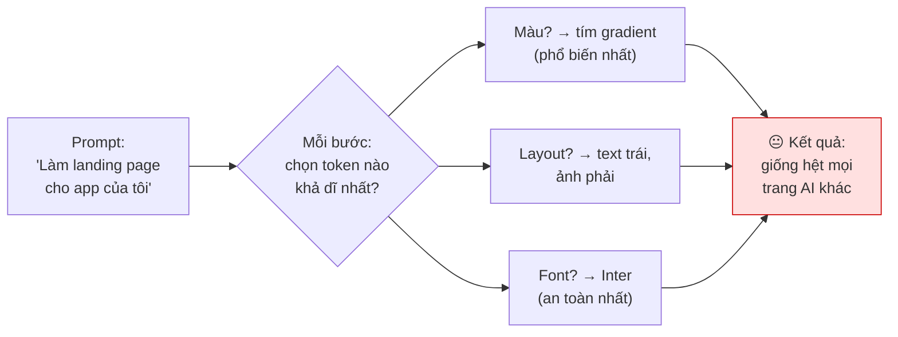

### 2.2. Nghịch lý cốt lõi

> **Thiết kế đẹp bắt đầu từ CẢM XÚC và nhằm tạo ra phản ứng cảm xúc. Nó bẻ cong luật lệ và làm người dùng thích thú bằng những lựa chọn đáng nhớ, bất ngờ.**
>
> **Thiết kế đẹp chính là điều NGƯỢC LẠI với bản năng của LLM — vốn luôn chọn phương án dễ đoán nhất ở mỗi bước.**

Tác giả gọi đây là **"design-by-committee"** (thiết kế theo kiểu họp hội đồng) ở mức cực đoan nhất: ai cũng đồng ý, và kết quả thì nhạt nhẽo.

### 2.3. Tin tốt

Hầu hết mọi người chỉ nhìn thấy **1% tiềm năng sáng tạo của AI**. Nếu ta ép được mô hình vươn ra khỏi vùng "lựa chọn dễ đoán nhất", ta sẽ chạm tới **99% còn lại** — một vùng ý tưởng rộng mênh mông mà đa số bỏ lỡ.

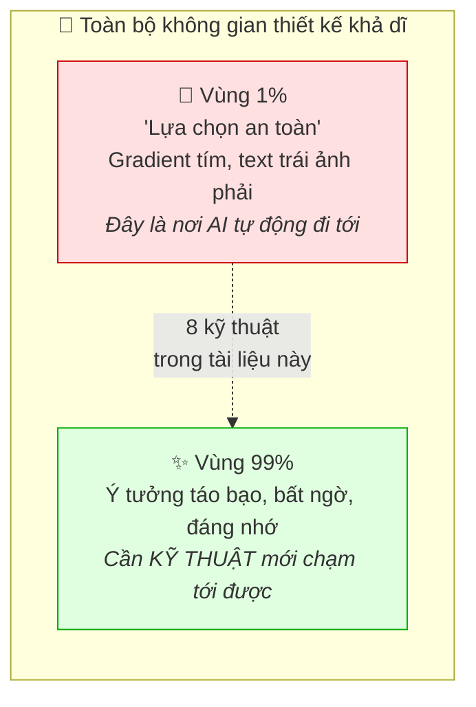

---

<a id="2"></a>
## 3. Tổng quan quy trình 3 giai đoạn

Tác giả lấy cảm hứng (một cách lỏng lẻo) từ **Double Diamond** — quy trình thiết kế kinh điển dùng cho designer người thật — và tái thiết kế nó cho **một đội agent AI**.

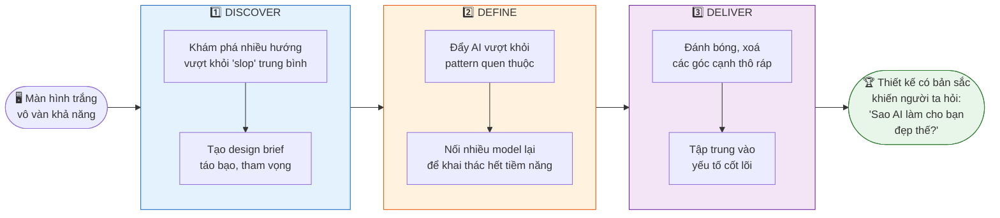

### Bản đồ 8 kỹ thuật

| Giai đoạn | Kỹ thuật | Mục đích |
|---|---|---|
| **DISCOVER** | 1. Seed string | Tiêm sự ngẫu nhiên THẬT từ bên ngoài |
| **DISCOVER** | 2. Prompt tham vọng | Đưa tầm nhìn rõ ràng, gu riêng của BẠN |
| **DEFINE** | 3. Subagent phê bình | Tạo vòng lặp cải tiến khách quan |
| **DEFINE** | 4. Image generation | Thay gradient rẻ tiền bằng ảnh thật |
| **DEFINE** | 5. Video generation | Chuyển động mà code không làm nổi |
| **DELIVER** | 6. Cắt bỏ | Bớt đi để trông cao cấp hơn |
| **DELIVER** | 7. Xoá dấu vết AI | Nhận diện & thay thế pattern nhàm |
| **DELIVER** | 8. Viết lại copy | Chữ do người viết, không phải AI |

---

<a id="3"></a>
## 4. Giai đoạn 1 — DISCOVER: Khám phá không gian khả dĩ

> **Nguyên tắc:** Phần khó nhất của thiết kế là khoảnh khắc nhìn vào màn hình trắng. Cách tốt nhất là **đi RỘNG trước, rồi mới đi SÂU**.

AI là công cụ tuyệt vời để khám phá nhiều hướng khác nhau — **nhưng** mô hình lại có xu hướng bám vào pattern quen thuộc và chọn phương án bảo thủ. Vậy ta phải ép nó làm điều ngược lại: **táo bạo, đa dạng, chấp nhận rủi ro**.

---

### 🔹 Kỹ thuật 1: Dùng "Seed String" để tiêm sự đa dạng

#### Thí nghiệm của tác giả

Anshu đưa **cùng một prompt** cho **4 instance Claude Code** khác nhau:

**Prompt (lần 1 — ngây thơ):**
```
Build me a landing page for my productivity app.
```
> *(Làm cho tôi một landing page cho app quản lý công việc của tôi.)*

**Kết quả với Claude Opus 5:** Gần như **mọi lần** đều ra:
- Gradient tím
- Text bên trái, graphic bên phải
- Cấu trúc y hệt nhau

→ *"Trông giống mọi website do AI thiết kế từng tồn tại."*

---

#### Thử lần 2: Chỉ cần xin "độc đáo" là được chứ gì?

**Prompt (lần 2):**
```
Build me a landing page for my productivity app. Give me something totally
unique. Make every design decision completely at random.
```
> *(Làm landing page cho app của tôi. Cho tôi thứ gì đó thật độc đáo. Hãy đưa mọi quyết định thiết kế một cách hoàn toàn ngẫu nhiên.)*

**Kết quả:** Khác lần trước, **nhưng vẫn không đa dạng**. Mô hình vẫn dùng:
- Cùng một bảng màu
- Cùng một cấu trúc
- Thậm chí cùng những ẩn dụ gốm sứ (pottery metaphors) kỳ quặc như nhau

> ⚠️ **Lý do then chốt:** Mô hình **không thể ngẫu nhiên một cách tự thân**. Nó chỉ có thể dự đoán token khả dĩ nhất. Nó đang dự đoán những token *nghe có vẻ ngẫu nhiên* nhưng *thực sự không hề ngẫu nhiên*.

---

#### Lời giải: String Seed of Thought

Nếu muốn sự đa dạng, ta phải **mang nó từ BÊN NGOÀI vào**. Kỹ thuật này có tên **String Seed of Thought**, công bố bởi **Sakana AI**.

Ý tưởng: bắt AI **sinh ra một chuỗi ngẫu nhiên thật** (bằng shell script — tức là ngẫu nhiên thật của hệ điều hành, không phải "ngẫu nhiên giả" của LLM), rồi dùng chuỗi đó làm nguồn cảm hứng thiết kế.

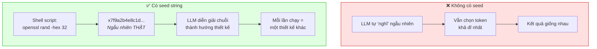

**Prompt chuẩn (dịch nguyên văn + bản tiếng Việt):**

```text
I want you to build me a landing page for my productivity app.

Follow this procedure:
1. Generate a long, random alphanumeric string using a shell script.
2. Define the creative direction (color scheme, layout, typography, etc.)
   based on the string. Look beyond the surface for subpatterns, special
   numbers, anything that inspires you.
3. Use your judgment to bring this direction to life and make it look great.

Don't reveal the string in the design. It's only for your inspiration.
```

**Bản tiếng Việt để bạn dùng luôn:**

```text
Tôi muốn bạn xây cho tôi một landing page cho app quản lý công việc.

Hãy làm theo quy trình sau:
1. Sinh một chuỗi ký tự chữ-số ngẫu nhiên, dài, bằng shell script.
2. Định nghĩa hướng sáng tạo (bảng màu, bố cục, typography, v.v.) DỰA TRÊN
   chuỗi đó. Nhìn sâu hơn bề mặt: tìm các mẫu con, con số đặc biệt, bất cứ
   thứ gì gợi cảm hứng cho bạn.
3. Dùng óc phán đoán của bạn để hiện thực hoá hướng đi đó và làm nó thật đẹp.

Đừng để lộ chuỗi đó trong thiết kế. Nó chỉ dành cho cảm hứng của bạn thôi.
```

**Kết quả:** Đột nhiên output **đa dạng hẳn lên** — bảng màu khác nhau, font khác nhau, ý tưởng mới.

> 💡 **Câu chốt của tác giả:** *"Các thiết kế trước đó là thứ mà BẤT KỲ người dùng Claude nào cũng có thể lấy được. Những thiết kế này là độc nhất vô nhị; không có hai lần chạy nào cho ra kết quả giống nhau."*

---

### 🔹 Kỹ thuật 2: Prompt tham vọng hơn RẤT NHIỀU

Cách thứ hai để đẩy mô hình ra khỏi vùng an toàn: **cụ thể hơn và "điên" hơn** trong prompt. Việc này cho mô hình một **tầm nhìn rõ ràng** để dựa vào, thay vì để nó tự bịa ra từng quyết định.

> **Chìa khoá:** Cách tốt nhất để tìm ý tưởng độc đáo là **đưa GU của chính bạn vào**. Bạn hình dung nguồn cảm hứng trước — một video game, một trend nội thất, một tác phẩm sắp đặt — rồi mô tả bạn muốn cảm hứng đó ảnh hưởng tới output của AI như thế nào.

#### 3 ví dụ prompt tham vọng (nguyên văn của tác giả)

**Ví dụ A — Pixel art:**
> *"Build me a landing page for my productivity app, with a bold pixel art theme and stunning graphics. Each section should feel like a still from a video game, yet somehow it should all function as a landing page."*
>
> 🇻🇳 *Làm landing page cho app của tôi, với chủ đề pixel art mạnh mẽ và đồ hoạ choáng ngợp. Mỗi section nên có cảm giác như một khung hình đứng từ một video game, nhưng bằng cách nào đó tất cả vẫn phải hoạt động như một landing page.*

**Ví dụ B — Thành phố 3D isometric:**
> *"Build me a landing page for my productivity app, set in an isometric living 3D city, where different features are somehow represented by neighborhoods or buildings."*
>
> 🇻🇳 *Làm landing page cho app của tôi, đặt bối cảnh trong một thành phố 3D isometric đang sống, nơi các tính năng khác nhau được biểu diễn bằng các khu phố hoặc toà nhà.*

**Ví dụ C — Phá luật có chủ đích:**
> *"Build me a landing page for my productivity app, with a radically asymmetric layout, dissonant colors and typography, and uncomfortable negative space. Break all the rules but still make it look good."*
>
> 🇻🇳 *Làm landing page cho app của tôi, với bố cục bất đối xứng triệt để, màu sắc và typography nghịch tai, và khoảng trắng gây khó chịu. Phá hết mọi luật lệ nhưng vẫn phải đẹp.*

---

#### Nhưng làm sao nghĩ ra ý tưởng gốc? → Quy trình 3 bước

Phần khó là **nghĩ ra ý tưởng độc đáo để yêu cầu**. AI cũng giúp được — nhưng nếu bạn chỉ hỏi "cho tôi ý tưởng", bạn sẽ nhận đúng những ý tưởng trung bình mà ai cũng nhận được.

Đây là **hệ thống tác giả dùng**:

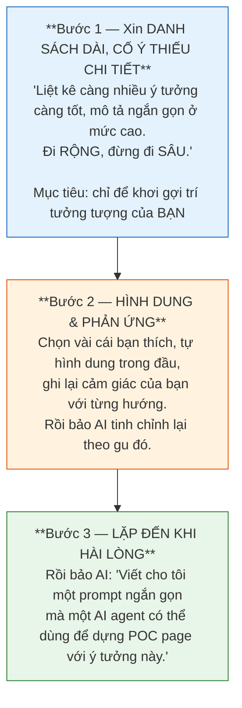

**Ví dụ hội thoại thật của tác giả:**

> **👤 Bạn:** *"Tôi muốn nghĩ ra một design language táo bạo, độc đáo cho sản phẩm của mình. Bạn liệt kê được bao nhiêu ý tưởng thì liệt kê, kèm mô tả ngắn ở mức cao. Đi rộng, đừng đi sâu."*
>
> **🤖 AI:** *(liệt kê nhiều ý tưởng, trong đó có)* **"Industrial Control Panel"** — bảng điều khiển công nghiệp…
>
> **👤 Bạn (đưa gu của mình vào — ĐÂY LÀ PHẦN QUAN TRỌNG NHẤT):**
> > *"Tôi đang hình dung thứ gì đó mang tính xúc giác. Nút bấm 'clicky' đã tay, âm thanh dễ chịu.*
> > *Ban đầu tôi tưởng tượng kiểu hoạt hình hoặc skeuomorphic, nhưng cái đó với tôi thấy rẻ tiền. Tránh nó ra.*
> > *Thay vào đó, tôi muốn các component nhất quán và những chi tiết nhỏ giúp đạt được cái 'look' này mà không bị quá đà.*
> > *Gradient xám thì chán. Cần nhiều texture hơn. Có thể đưa thêm chút màu vào mà vẫn giữ được cảm giác control panel không?*
> > **Bạn mài sắc ý tưởng này lại theo gu của tôi được không?"**
>
> **👤 Bạn (bước 3):** *"Viết cho tôi một prompt ngắn gọn mà một AI agent có thể dùng để dựng một trang POC ban đầu với ý tưởng này?"*

> ⚠️ **Cảnh báo quan trọng:** *"Nếu bạn chỉ copy ý tưởng do AI sinh ra rồi paste ngược lại vào AI, rất khó ra được thứ gì độc đáo. Vì ai khác cũng có thể làm y hệt. Tuy nhiên, khi bạn CHỦ ĐỘNG lái hướng thiết kế, bạn sẽ có được thứ mà chỉ MÌNH BẠN có thể tạo ra."*

#### 💎 Hai lời khuyên vàng ở cuối giai đoạn Discover

1. **Đừng sợ thử những ý tưởng nghe có vẻ tệ.** Nếu bạn thấy mình đang nghĩ *"Không đời nào cái này chạy được"* — bạn đang đi đúng hướng. Agent thường sẽ làm bạn bất ngờ, và bạn sẽ nhận ra mình đã đánh giá thấp nó.

2. **LƯU LẠI những prompt không thành công.** Thử lại chúng khi có model mới ra mắt. Nhờ vậy bạn luôn biết mình đang tận dụng hết sức mạnh của các model mới nhất.

---

<a id="4"></a>
## 5. Giai đoạn 2 — DEFINE: Đào sâu hướng thiết kế

Dù prompt kiểu gì, thiết kế AI tạo ra **ban đầu vẫn thường cảm giác chung chung**. Ví dụ ngay cả các thiết kế từ seed string ở trên vẫn bám vào các pattern cũ: *text bên trái với nút CTA bên dưới, nav bar trên cùng, graphic bên phải*.

**Mục tiêu giai đoạn này:** cho mỗi thiết kế một **cá tính riêng** thông qua những lựa chọn thiết kế đặc trưng.

---

### 🔹 Kỹ thuật 3: Tạo vòng lặp phản hồi tích cực với subagent

#### Vì sao không thể bảo agent "tự nhìn lại và cải thiện"?

Vì **agent không khách quan**: nó đang review chính code của nó, chính các quyết định trước đó của nó, chính lý lẽ trước đó của nó. AI khó mà zoom out, nhìn bức tranh lớn, và "think different".

#### Lời giải: tách vai trò

Thay vì để coding agent tự quyết định khi nào thiết kế đủ tốt, hãy bắt nó **hỏi một agent khác — một "design critic" (nhà phê bình thiết kế)**.

Việc của critic: **chỉ nhìn ảnh chụp màn hình** của thiết kế hiện tại và đưa phản hồi. Nó **không quan tâm** thiết kế được code thế nào, hay đã tốn bao nhiêu công sức — chỉ quan tâm nó có đạt chuẩn chất lượng hay không.

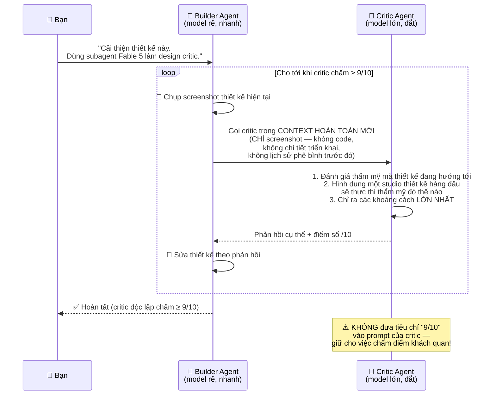

#### 💰 Lợi ích kép về chi phí

> Ta có thể dùng **model to, đắt tiền** cho vai trò critic **mà không cháy túi**, vì ta chỉ dùng nó cho các **quyết định cấp cao**. Một model **rẻ, nhanh** làm việc tay chân; model critic mạnh cung cấp **gu thẩm mỹ**.

**Số liệu thật từ bài viết:** Trong mỗi trường hợp, **Fable 5 chiếm chưa tới 10% tổng output token**. Nếu bảo thẳng Fable thiết kế lại cả trang, chi phí sẽ **đắt gấp đôi** và **lâu hơn nhiều**.

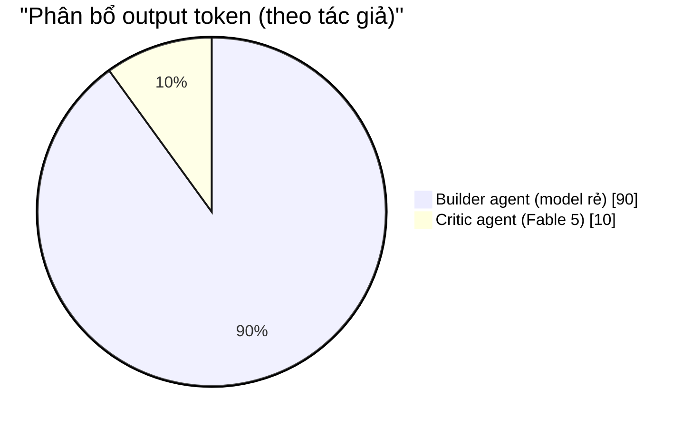

#### Prompt đầy đủ (nguyên văn tác giả)

```text
I want you to improve this design. To figure out what to focus on, use a
Fable 5 subagent as a design critic.

Follow this procedure at each iteration:
- Capture a screenshot of the current design
- Invoke the critic in a fresh context, with just the screenshot, not the
  code, implementation details, or earlier iterations/critiques
- Ask it to evaluate the aesthetic that the design is going for, imagine how
  a top design studio would execute this aesthetic, then outline the biggest gaps
- Lastly, it should provide a score out of 10 indicating how close the current
  design is to that studio-level quality bar

Provide this guidance to the critic in its prompt:
- It should think high-level about the overall structure and composition as
  well as look at the fine details
- It should watch out for patterns that feel overdone, excessive, or otherwise
  obviously AI-generated, and penalize them
- It should provide tight, specific feedback, not vague prose
- It should be bold and opinionated, not rely on what's safe or easy

Your work is only complete when the critic independently deems it 9/10 or
higher. Do not put that criterion in the critic prompt; keep it objective in
its scoring. Use the same critic prompt each time.
```

**Bản tiếng Việt:**

```text
Tôi muốn bạn cải thiện thiết kế này. Để xác định cần tập trung vào đâu, hãy
dùng một subagent Fable 5 làm design critic (nhà phê bình thiết kế).

Ở mỗi vòng lặp, hãy làm theo quy trình sau:
- Chụp ảnh màn hình thiết kế hiện tại
- Gọi critic trong một context HOÀN TOÀN MỚI, CHỈ đưa ảnh chụp màn hình —
  không đưa code, không chi tiết triển khai, không các vòng lặp/phê bình trước
- Yêu cầu nó: đánh giá thẩm mỹ mà thiết kế đang hướng tới, hình dung một studio
  thiết kế hàng đầu sẽ thực thi thẩm mỹ đó ra sao, rồi chỉ ra các khoảng cách lớn nhất
- Cuối cùng, nó phải đưa một điểm số trên thang 10, thể hiện thiết kế hiện tại
  cách chuẩn chất lượng cỡ studio bao xa

Đưa các hướng dẫn sau vào prompt của critic:
- Phải tư duy ở tầm cao về cấu trúc và bố cục tổng thể, ĐỒNG THỜI soi các chi tiết nhỏ
- Phải cảnh giác với các pattern bị lạm dụng, quá đà, hoặc rõ ràng là do AI tạo ra,
  và TRỪ ĐIỂM chúng
- Phải đưa phản hồi chặt chẽ, cụ thể — không phải văn vẻ mơ hồ
- Phải táo bạo và có chính kiến, không dựa vào cái an toàn hay dễ dàng

Công việc của bạn chỉ hoàn thành khi critic ĐỘC LẬP chấm từ 9/10 trở lên.
ĐỪNG đưa tiêu chí đó vào prompt của critic; giữ cho việc chấm điểm khách quan.
Dùng CÙNG MỘT prompt critic ở mọi lần.
```

**Kết quả:** Thay vì cùng một bố cục rập khuôn lặp đi lặp lại, mỗi thiết kế giờ có **bản sắc riêng** — nhưng vẫn giữ được thẩm mỹ tổng thể ban đầu.

---

#### ⚙️ 4 mẹo thiết lập vòng lặp (phần quan trọng nhất)

**Mẹo 1 — Tiêu chí cho critic phải rõ ràng và khách quan nhất có thể**

| Mức | Prompt ví dụ | Nhận xét của tác giả |
|---|---|---|
| ❌ **Tệ** | *"Hãy đánh giá xem thiết kế của chúng ta có đẹp không, có giống AI tạo không."* | Quá chủ quan, kết quả dao động điên loạn giữa các lần chạy |
| 🟡 **Tạm được** | *"Xem xét thẩm mỹ mà ta đang hướng tới, hình dung một studio hàng đầu thực thi nó ra sao, rồi chấm chất lượng thiết kế của ta so với chuẩn đó."* | Vẫn còn mơ hồ, nhưng đã cung cấp **khung tham chiếu và chuẩn chất lượng nhất quán** |
| ✅ **Tuyệt** | *"Đây là 5 thiết kế: 4 ví dụ chuyên nghiệp và 1 ảnh chụp sản phẩm của chúng ta. Hãy xếp hạng chúng theo độ tinh tế và mức độ 'có gu'."* | **Cụ thể, khách quan**, và đưa ra **mốc so sánh trực quan** |

**Mẹo 2 — Cung cấp ảnh ví dụ làm chuẩn chất lượng**

Dùng screenshot tương đương, các thiết kế bạn thích, hoặc thậm chí concept art do AI tạo. **Hướng dẫn critic coi chúng là *baseline* hoặc *moodboard*, KHÔNG phải *mục tiêu*** — bạn không muốn nó copy nguyên xi thiết kế của người khác.

**Mẹo 3 — Đặt điều kiện dừng cẩn thận**

Nếu không, critic có thể **không bao giờ thấy đủ tốt**, và agent của bạn sẽ đốt token vô vọng để làm hài lòng nó.
→ Hãy bảo nó **chạy 1–2 vòng trước**, xem có đang hội tụ không, rồi mới tăng số vòng.

**Mẹo 4 — Chọn đúng model cho từng vai trò**

- **Critic:** cân nhắc model **lớn hơn** — nhiều tham số thường đồng nghĩa với **gu thiết kế tốt hơn** và **phân phối ý tưởng rộng hơn**
- **Implementer:** model nhỏ có thể hiệu quả, **nhưng đừng nhỏ quá**. Bạn vẫn cần một model đủ năng lực để thực thi tốt một hướng thiết kế.

---

### 🔹 Kỹ thuật 4: Dùng Image Generation để làm giàu thiết kế

#### Vấn đề

> **Coding agent thích viết code, nhưng chúng thường không đưa ảnh vào.** Thay vào đó, chúng dùng các phương án thay thế dễ dàng bằng code: **gradient, hình khối, và pattern cơ bản**. Tất cả những thứ đó đều là **dấu hiệu rõ rệt của một thiết kế do AI tạo ra**.

Một số agent có sẵn công cụ tạo ảnh nhưng **ít khi dùng tới**. Số khác không có sẵn nhưng có thể dễ dàng gọi API của OpenAI hoặc Gemini với một API key.

#### Prompt mẫu

```text
The design is pretty plain. Add more personality using image generation.
Consider shaders or 3D effects in combination with images to create more
interesting visuals.

For image generation, use this OpenAI API key (only use it locally, do not
store it in the code or product): sk-a1b2c3d4…

Verify that your work looks right frame-by-frame in the browser.
```

**Bản tiếng Việt:**

```text
Thiết kế này khá nhạt. Hãy thêm cá tính bằng cách dùng image generation.
Cân nhắc dùng shader hoặc hiệu ứng 3D kết hợp với ảnh để tạo visual thú vị hơn.

Để tạo ảnh, dùng OpenAI API key này (chỉ dùng cục bộ, KHÔNG lưu vào code
hoặc sản phẩm): sk-a1b2c3d4…

Hãy kiểm chứng kết quả trông đúng không, từng frame một, trên trình duyệt.
```

> *"Ảnh và hiệu ứng như thế này nhanh chóng thêm rất nhiều cá tính và làm thiết kế bớt lộ rõ là AI tạo ra, vì chúng thể hiện nỗ lực sâu hơn mức bề mặt."*

#### 🔌 Cách kết nối agent với công cụ tạo ảnh (theo từng tình huống)

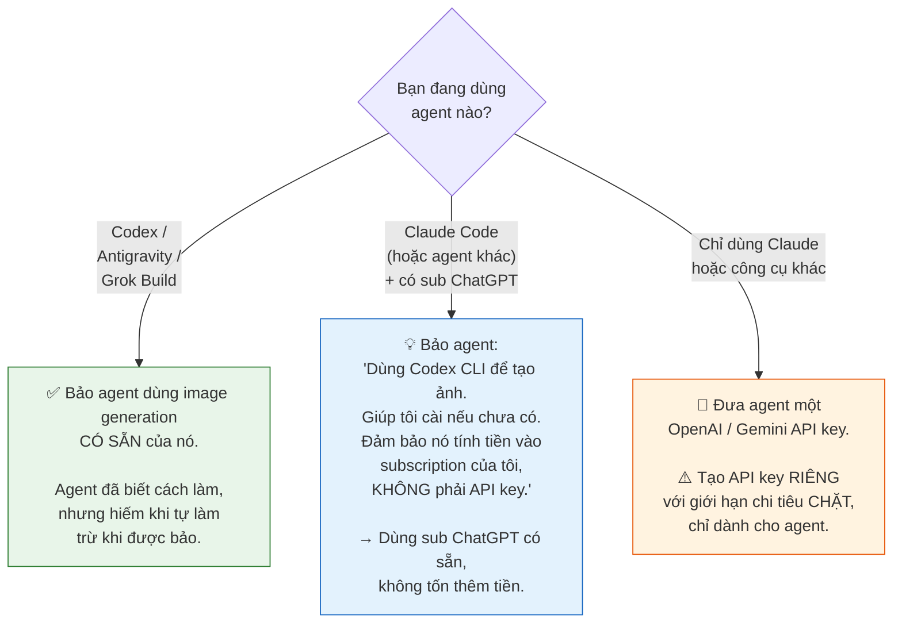

#### 🔐 Bảo mật API key — lời khuyên thực chiến

Tạo key riêng với spend limit chặt để: **chi phí được kiểm soát ngay cả khi key bị lộ hoặc agent dùng sai**, và bạn có thể **thu hồi key dễ dàng** mà không ảnh hưởng công việc khác.

Nếu bạn thấy mình phải paste key vào chat liên tục, hãy **để nó trong file** và trỏ agent tới đó. Bảo agent:

```text
Create a gitignored file called .env.agents, store this API key in it, and
note to yourself in AGENTS.md/CLAUDE.md that these keys are for you to use
during development (but must not ship with the product).
```

> 🇻🇳 *Tạo một file tên `.env.agents` đã được gitignore, lưu API key này vào đó, và tự ghi chú trong `AGENTS.md`/`CLAUDE.md` rằng các key này là để bạn dùng trong lúc phát triển (nhưng KHÔNG được đi kèm sản phẩm khi ship).*

---

### 🔹 Kỹ thuật 5: Dùng Video Generation cho chuyển động nâng cao

> Model tạo video ngày nay cực kỳ mạnh, nhưng đa số mọi người chỉ nghĩ chúng dùng để làm quảng cáo UGC hoặc clip "Will Smith ăn mì spaghetti". **Chúng cũng làm nên điều kỳ diệu cho công việc thiết kế hàng ngày.**

**Mẹo hạ tầng:** Có rất nhiều video model và model tốt nhất thay đổi liên tục, nên tác giả thích dùng một **nền tảng tổng hợp như `fal.ai`**. Như vậy ta chỉ cần đưa agent **một API key duy nhất** và để nó tự đánh giá, tự chọn model tốt nhất — không cần tích hợp nhiều thứ.

#### Ứng dụng 5a — Tạo đồ hoạ động choáng ngợp

**Thủ thuật cốt lõi:** Tạo một clip **lặp (loop)** với **nền màu đơn sắc**, rồi hoặc **chroma key** nó ra (như phông xanh), hoặc trong trường hợp phức tạp hơn thì dùng **video matting model** để xoá nền. Kết quả: bạn có một animation có thể **xếp lớp ở bất cứ đâu trong UI** mà không trông giống một video.

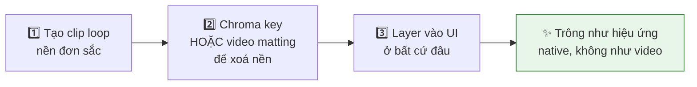

**Prompt thật của tác giả:**

```text
Can you replace the image on this page with a looping video clip that does
something more interesting? Have the crystal splinter apart and slowly spin
around. It should have awesome glassy effects that refract the page background
and cast shadows and light around it.

To get convincing glass refraction effects, render the video of the glass over
the page background colors first (so it bakes in the refraction effects), then
remove the background with a video matting model.

Use this fal.ai API key: sk-a1b2c3d4…
Find appropriate recent models for video generation and background removal.
```

**Bản tiếng Việt:**

```text
Bạn thay ảnh trên trang này bằng một clip video lặp làm điều gì đó thú vị hơn
được không? Hãy để khối pha lê vỡ tách ra và xoay chậm. Nó nên có hiệu ứng
thuỷ tinh tuyệt đẹp, khúc xạ nền trang và hắt bóng + ánh sáng xung quanh.

Để có hiệu ứng khúc xạ thuỷ tinh thuyết phục, hãy render video khối thuỷ tinh
TRÊN NỀN MÀU của trang TRƯỚC (để nó "nướng" sẵn hiệu ứng khúc xạ vào), SAU ĐÓ
mới xoá nền bằng video matting model.

Dùng fal.ai API key này: sk-a1b2c3d4…
Hãy tự tìm các model gần đây phù hợp cho tạo video và xoá nền.
```

**Kết quả (GPT-5.6 Sol):** Hiệu ứng phong phú hơn nhiều so với những gì code làm được — **phản chiếu caustic thú vị, khúc xạ thuỷ tinh, và chuyển động vật lý phức tạp**.

---

#### Ứng dụng 5b — Chuyển cảnh tương tác (use case bị đánh giá thấp)

Ngoài việc tạo video từ text, **nhiều video model có thể nội suy (interpolate) giữa các ảnh keyframe**. Điều này cho phép bạn lấy **hai ảnh sản phẩm tĩnh** và tạo một **clip chuyển tiếp** giữa chúng.

Bạn có thể:
- **Phát clip** khi người dùng thực hiện hành động (ví dụ: điều hướng sang màn hình khác)
- **Tua từng frame** (scrub) theo cử chỉ của người dùng (ví dụ: cuộn hoặc vuốt)

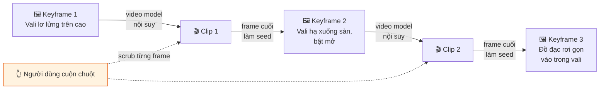

**Prompt (1 prompt duy nhất, dùng GPT-5.6 Sol trong Codex):**

```text
Build a demo page for a suitcase that uses a video model to create interactive
transitions between a couple of screens. Each screen should show the suitcase
in a different state, with vertical motion that feels appropriate for scrolling:
- Initially, have the suitcase floating high up in the air
- Then have it land on the floor and pop open
- Finally, have its contents neatly land into it from the top

Create fluid transitions between states.

Generate the initial frame using your image generation skill. Then, generate a
video clip that starts from that frame and animates to the next state. Use the
final frame of that video to seed the next transition so that it continues
seamlessly. Scrub through the transitions one by one as the user scrolls.

Use this fal.ai API key: sk-a1b2c3d4…
Use a video model with strong physics and consistency, like Seedance 2.5.
```

**Bản tiếng Việt:**

```text
Dựng một trang demo cho một chiếc vali, dùng video model để tạo các chuyển cảnh
tương tác giữa vài màn hình. Mỗi màn hình thể hiện vali ở một trạng thái khác
nhau, với chuyển động theo chiều dọc phù hợp với thao tác cuộn:
- Ban đầu, vali lơ lửng trên cao
- Sau đó hạ cánh xuống sàn và bật mở ra
- Cuối cùng, đồ bên trong rơi gọn gàng vào vali từ phía trên

Tạo các chuyển tiếp mượt mà giữa các trạng thái.

Hãy tạo frame đầu tiên bằng kỹ năng image generation của bạn. Sau đó tạo một
clip video bắt đầu từ frame đó và animate sang trạng thái kế tiếp. Dùng frame
CUỐI của video đó làm seed cho chuyển tiếp tiếp theo để mạch nối liền mạch.
Tua (scrub) qua từng chuyển tiếp một khi người dùng cuộn.

Dùng fal.ai API key này: sk-a1b2c3d4…
Dùng một video model có vật lý và tính nhất quán mạnh, ví dụ Seedance 2.5.
```

> **Kết quả:** *"Các chuyển tiếp giữa các trang tua mượt theo thao tác cuộn của người dùng và rất vui để nghịch. Thiết kế kiểu này khiến người dùng muốn cuộn tiếp và đọc thêm về sản phẩm của bạn. Và nó chỉ tốn một prompt duy nhất!"*

---

<a id="5"></a>
## 6. Giai đoạn 3 — DELIVER: Đánh bóng thành thứ người dùng yêu thích

Khi đã có một thiết kế độc đáo, nổi bật, bước cuối là **dọn dẹp chi tiết** và chuẩn bị cho production.

> **AI có thể dựng những visual ấn tượng, nhưng PHÁN ĐOÁN CỦA BẠN mới là thứ quyết định thiết kế có hợp lý, có mạch lạc, và có phục vụ đúng mục đích thực tế cho người dùng hay không.**

---

### 🔹 Kỹ thuật 6: Cắt bỏ những thứ không tạo giá trị

> **Luật vàng:** *"AI thích THÊM VÀO, nhưng hiếm khi nó BỚT ĐI."*

Một trong những dấu hiệu lớn nhất của thiết kế do AI tạo: nó **giải thích quá nhiều thứ** hoặc chứa **các phần tử không phục vụ mục đích thực tế nào**. Ngược lại, một thiết kế biết **tiết chế** lập tức trông **cao cấp và có gu**.

> *"Khi đánh bóng các thiết kế AI, phần lớn nỗ lực của tôi là dành cho việc LOẠI BỎ."*

#### 📱 Case study: App đếm calo của tác giả

Anshu mô tả chức năng app và **nói rõ là muốn "thiết kế tối giản, sạch sẽ"**. Claude trả về một kết quả *không tệ*, rất ấn tượng với một thứ hoàn toàn do AI tạo. **Nhưng** dù đã yêu cầu tối giản, rất nhiều thứ trong thiết kế **không tạo thêm giá trị**:

| ❌ Vấn đề trong bản đầu | Vì sao là vấn đề |
|---|---|
| Hiệu ứng phát sáng hồng ở nền và trên thanh progress | Trang trí thuần tuý, không truyền tải thông tin |
| Màu sắc và highlight ngẫu nhiên trên chữ | Gây nhiễu, không có hệ thống |
| Nhãn thừa và khoảng trống khi hiển thị toàn bộ món ăn trong ngày | **Ảnh đã truyền đạt điều đó rồi** |
| Button và text field tự custom | **Trông tệ hơn component gốc của iOS** |

#### Prompt sửa (3 câu, cực kỳ trực diện)

```text
- Simplify the layout into an image-centric grid
- Get rid of gradients, glows, and unnecessary containers
- Aim for a truly minimalist aesthetic that feels Apple-native
```

**Bản tiếng Việt:**

```text
- Đơn giản hoá bố cục thành một lưới lấy ảnh làm trung tâm
- Bỏ hết gradient, hiệu ứng phát sáng, và các container không cần thiết
- Hướng tới một thẩm mỹ tối giản THỰC SỰ, có cảm giác native của Apple
```

**Kết quả theo đánh giá của tác giả:** *"Với con mắt đã rèn luyện của tôi, kết quả tốt hơn nhiều. Nó có chính kiến và để visual tự lên tiếng. Nó dùng component iOS gốc, và màu sắc + gradient thừa thãi đã biến mất. Chữ nhỏ hơn, đơn giản hơn, chặt chẽ hơn. **Đây mới là thiết kế tốt.**"*

#### ⚠️ Vì sao AI không tự làm được điều này?

> *"Các model AI ngày nay sẽ KHÔNG BAO GIỜ tự nghĩ ra việc đưa ra những lựa chọn này. Hãy nhớ: **AI không thích mạo hiểm**, và việc lột trần một thiết kế rồi xoá code là một việc MẠO HIỂM. Model cần một cú đẩy từ BẠN."*

**Câu hỏi tự vấn khi review:** *"Thứ gì thực sự CẦN phải có mặt ở đây?"*

> *"Thông thường, đặt ÍT hơn lên màn hình lại truyền đạt NHIỀU hơn, vì bạn giữ được sự chú ý của người dùng mà không áp đảo họ bằng mớ hỗn độn."*

---

### 🔹 Kỹ thuật 7: Xoá các "dấu vết AI" (AI tells)

Mỗi model AI đều có những pattern nó **thích lạm dụng**. Bản thân chúng không xấu — nhưng một khi người dùng bắt đầu nhìn thấy chúng trong **mọi thiết kế**, chúng trở thành **dấu hiệu nhận biết của "AI slop"**.

#### 📋 Bảng 4 dấu vết AI phổ biến & phương án thay thế

> *(Bảng này trong bài gốc là ảnh so sánh trực quan trái–phải; tôi đã trích xuất và dịch lại nội dung.)*

| # | ❌ Pattern bị lạm dụng | ✅ Phương án tốt hơn |
|---|---|---|
| **1** | **Eyebrow text** — các nhãn nhỏ, thừa, nằm trên tiêu đề, chỉ nói lại điều hiển nhiên<br/><br/>*VD: dòng chữ nhỏ màu cam `EXPENSE MANAGEMENT` phía trên tiêu đề "Control company spending before it happens."* | **9 trên 10 lần, bạn chỉ cần XOÁ nó đi và không mất gì cả.**<br/><br/>*Kết quả: tiêu đề to hơn, thở hơn, mạnh hơn.* |
| **2** | **Gradient nền chung chung**<br/><br/>*VD: hero section nền gradient xanh dương chuyển sắc — đẹp nhưng vô hồn và ai cũng có.* | **Ảnh nền, pattern, hoặc thậm chí MÀU ĐẶC.**<br/><br/>*VD: cùng hero đó nhưng nền là ảnh thật một căn nhà gỗ trong rừng thông lúc chạng vạng → lập tức có không khí, có câu chuyện.* |
| **3** | **Quá nhiều card và container**<br/><br/>*VD: 3 feature nằm trong 3 card có viền, bo góc, đổ bóng, lại nằm trong một container lớn khác.* | **Bố cục PHẲNG hơn như lưới (grid) hoặc ô xếp (tiles).**<br/><br/>*VD: cùng 3 feature đó nhưng bỏ viền/bóng, chỉ dùng khoảng trắng để phân nhóm → sạch và cao cấp hơn.* |
| **4** | **Quá nhiều font, kiểu chữ, và cấp độ typography**<br/><br/>*VD: "Make space **for better ideas**" — chữ "for better ideas" đổi sang font nghiêng + màu khác, cùng lúc có 4-5 cỡ chữ khác nhau trên một màn hình.* | **Bắt đầu với 1–2 font và 2–4 kiểu, cho tới khi bạn thực sự cần thêm; dùng màu nhấn và chữ nghiêng một cách TIẾT KIỆM.**<br/><br/>*VD: cùng dòng tiêu đề nhưng để nguyên một font, một màu → vẫn đẹp, lại cao cấp hơn.* |

#### ⚠️ Lời khuyên QUAN TRỌNG về cách dùng bảng này

> *"Bạn **có thể** prompt AI cấm các pattern này ngay từ đầu, **nhưng tôi KHÔNG khuyến nghị**. Không phải gradient, card, hay label nào cũng xấu bản chất, và ép AI tránh chúng có thể khiến nó **suy nghĩ quá mức và đẻ ra những pattern còn lạ lùng hơn**."*

**Cách làm đúng:**

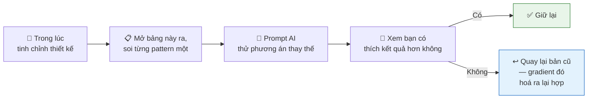

---

### 🔹 Kỹ thuật 8: Viết lại copy (nội dung chữ) BẰNG TAY

> *"Chữ mà model đặt vào thiết kế không ảnh hưởng tới visual, **nhưng nó có thể là yếu tố ẢNH HƯỞNG LỚN NHẤT** tới việc người dùng cảm nhận thiết kế của bạn là **có gu** hay là **slop**."*

Lý do: chúng ta **bị dội bom bởi văn bản do AI tạo mỗi ngày**. Nó mệt mỏi để đọc và đơn giản là **không tự nhiên**.

#### 💡 Phép ẩn dụ then chốt

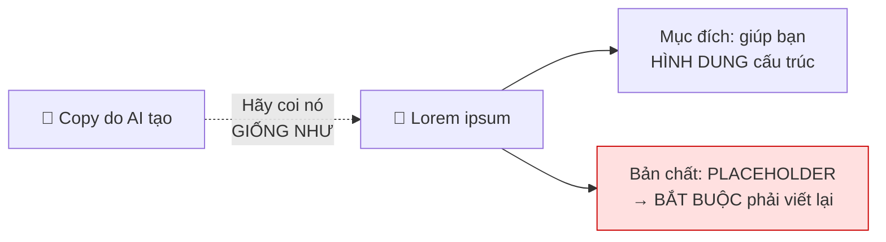

> *"Hãy đảm bảo một CON NGƯỜI đọc từng dòng copy và diễn đạt lại bằng một giọng văn nhất quán."*

#### 📊 Ví dụ so sánh thật từ bài viết (sản phẩm "Lantern")

Cả hai đều giữ nguyên tiêu đề: ***"Stop guessing why your database is slow."***

<table>
<tr><th width="50%">❌ Copy marketing do Claude viết</th><th width="50%">✅ Bản tác giả viết lại</th></tr>
<tr valign="top"><td>

> Log của bạn nói 1.4 giây. Chúng không nói **tại sao**. Ở đâu đó giữa ORM và ổ đĩa, thời gian đang biến mất — và việc tìm ra nó thường đồng nghĩa với một chiều thứ Năm nheo mắt nhìn output `EXPLAIN ANALYZE` đọc như thư tống tiền. Lantern trả lại cho bạn buổi chiều đó.
>
> Kết nối một chuỗi read-only và Lantern bắt đầu xếp hạng mọi query theo thời gian nó THỰC SỰ tốn của bạn — để cái query 4ms chạy 200.000 lần một ngày cuối cùng cũng được chú ý xứng đáng. Mỗi cái link thẳng tới dòng code đã kích hoạt nó. Không agent, không sidecar, không YAML. Chúng tôi chỉ bắt hình dạng query chứ không bao giờ bắt tham số, nên dữ liệu khách hàng của bạn ở yên trong database của bạn, nơi nó thuộc về.
>
> Phần lớn đội tìm ra bản vá có ý nghĩa đầu tiên trong vòng một giờ. Thường là một index bị thiếu. Gần như LUÔN LUÔN là một index bị thiếu.
>
> Bắt đầu miễn phí — một database, mãi mãi.

**→ 4 đoạn, ~200 từ, đầy ẩn dụ văn vẻ**

</td><td>

> Đừng bao giờ phí một buổi chiều đọc profile `EXPLAIN ANALYZE` nữa. Lantern là query analyzer chạy bằng AI, hoạt động với mọi database, tìm ra vấn đề hiệu năng ngay khi chúng xuất hiện, và chỉ cho bạn chính xác dòng code gây ra. Nó hoàn toàn riêng tư và không bao giờ đọc dữ liệu của bạn.
>
> Phần lớn đội tìm ra vấn đề nghiêm trọng đầu tiên trong vòng một giờ sau khi đăng ký. Kết nối database đầu tiên miễn phí.

**→ 2 đoạn, ~70 từ, đi thẳng vào giá trị**

</td></tr>
</table>

> **Kết luận của tác giả:** *"Bản của người gần như luôn **ngắn hơn, đơn giản hơn, và ít gây 'trợn mắt' hơn**. Khi người dùng thấy một bức tường chữ do AI tạo, họ lập tức muốn lướt qua. Hãy bỏ công viết copy rõ ràng, có chủ đích, và người dùng sẽ **thực sự đọc** những gì bạn muốn nói."*

---

<a id="6"></a>
## 7. Checklist thực chiến: Làm một landing page từ A→Z

Đây là phần tôi tổng hợp lại thành quy trình bạn có thể làm theo ngay.

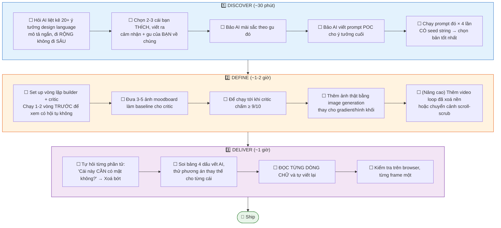

### ⚡ Bảng tra nhanh: lỗi thường gặp của người mới

| Bạn đang làm | Vì sao sai | Làm thế này thay vào |
|---|---|---|
| "Làm cho tôi landing page đẹp" | Quá mơ hồ → AI rơi vào vùng 1% an toàn | Dùng seed string + prompt tham vọng (KT 1, 2) |
| "Hãy làm nó ngẫu nhiên hơn" | LLM không thể ngẫu nhiên tự thân | Sinh chuỗi ngẫu nhiên bằng shell script (KT 1) |
| "Nhìn lại thiết kế và cải thiện đi" | Agent không khách quan với chính nó | Dùng critic subagent trong context mới (KT 3) |
| Dùng model đắt nhất cho mọi thứ | Đốt tiền vô ích | Model rẻ build + model đắt chấm điểm (KT 3) |
| "Đừng dùng gradient, đừng dùng card…" ngay từ đầu | AI overthink, đẻ ra pattern lạ hơn | Để nó làm tự nhiên, rồi soi bảng AI tells khi tinh chỉnh (KT 7) |
| Ship luôn copy do AI viết | Đây là thứ lộ "mùi AI" rõ nhất | Coi nó là Lorem ipsum, viết lại tay (KT 8) |
| Thấy thiết kế "hơi trống" → bảo AI thêm vào | AI vốn đã thêm quá nhiều rồi | Hỏi "cái gì CẦN ở đây?" rồi xoá bớt (KT 6) |

---

<a id="7"></a>
## 8. Tổng kết

### Ba giai đoạn, một lần nữa

1. **Discover** — Khám phá ý tưởng mới, vượt khỏi mặc định "AI slop"
2. **Define** — Định hình một bản sắc thiết kế của riêng BẠN và sản phẩm của bạn
3. **Deliver** — Giao một kết quả cuối thú vị, bằng cách đánh bóng đi những góc cạnh thô ráp kiểu AI

### Lời kết của tác giả

> *"Phần lớn các thiết kế do AI tạo ra ngày nay là slop, nhưng **AI có thể là một designer rất giỏi khi được chỉ đạo đúng cách**. Khi AI tiếp tục tiến bộ, các model mới sẽ mở ra những khả năng thiết kế mà designer người thật chỉ dám mơ — **nếu chúng ta biết cách lái chúng**. Một khi AI trở thành một phần của mọi quy trình thiết kế, **lợi thế sẽ đến từ việc biết cách khai thác được nhiều hơn từ nó**."*
>
> *"Rốt cuộc, 'gu' và 'slop' nằm ở mắt người nhìn. Thiết kế tuyệt vời kết hợp font, màu, bố cục để **gợi lên một CẢM GIÁC**, chứ không chỉ tạo ra một bố cục thị giác. Nếu sản phẩm của bạn mang lại cảm giác thích thú khi dùng, **người dùng sẽ không quan tâm nó được Claude thiết kế trong một ngày hay một đội người làm trong nhiều tháng**. Hãy tập trung vào CẢM GIÁC, và thiết kế của bạn sẽ luôn nổi bật — dù do AI tạo ra hay không."*

---

## 📚 Nguồn tham khảo & Trích dẫn (Citation)

### Nguồn gốc
| Thông tin | Chi tiết |
|---|---|
| **Tiêu đề gốc** | *How to turn your AI into a world-class designer — An end-to-end process for tapping into AI's hidden creativity* |
| **Tác giả** | **Anshu Chimala** (guest post) |
| **Xuất bản trên** | **Lenny's Newsletter** (Lenny Rachitsky), nền tảng Substack |
| **Ngày đăng** | 01/09/2026 (SEP 01, 2026) — bài trả phí (PAID) |
| **Tương tác ghi nhận trong file** | 566 likes, 36 restacks, 17 comments |
| **File nguồn cục bộ** | `How to turn your AI into a world-class designer.pdf` (31 trang, 13.2 MB) |
| **Bản quyền** | © 2026 Substack Inc. |

### Hồ sơ tác giả (theo bài viết)
- 12 năm dẫn dắt đội kỹ thuật phần mềm và thiết kế tại **Apple**, tập trung nghiên cứu & prototyping cho sản phẩm AI tương lai
- Cựu founder **Y Combinator**
- Thường xuyên chia sẻ tutorial và demo thiết kế AI trên **X (Twitter)**; có Substack riêng và LinkedIn

### Nguồn kỹ thuật được bài viết dẫn lại
| Nguồn | Dùng ở đâu |
|---|---|
| **String Seed of Thought** — công bố bởi **Sakana AI** | Kỹ thuật 1 (seed string) |
| **Double Diamond design process** | Khung quy trình 3 giai đoạn (bài viết ghi rõ là "lấy cảm hứng một cách lỏng lẻo") |

### Công cụ / Model được nhắc tên trong bài
- **Model:** Claude Opus 5, Claude Fable 5, GPT-5.6 Sol, Seedance 2.5
- **Agent/CLI:** Claude Code, Codex (CLI), Antigravity, Grok Build
- **API/Nền tảng:** OpenAI API, Gemini API, **fal.ai** (aggregator cho video model)

### Ghi chú về quá trình dịch & biên soạn
- Toàn bộ **31 trang** PDF đã được trích xuất (text layer qua `pypdf`).
- **Trang 26 và 28** không có text layer (hoàn toàn là ảnh) — tôi đã render chúng thành PNG ở 130 DPI bằng `PyMuPDF` và đọc nội dung trực tiếp từ ảnh. Đây là nguồn của **bảng 4 dấu vết AI** (Kỹ thuật 7) và **bảng so sánh copy "Lantern"** (Kỹ thuật 8).
- Các prompt được giữ **nguyên văn tiếng Anh** kèm **bản dịch tiếng Việt** bên dưới, vì prompt nên dùng đúng ngôn ngữ gốc để đạt kết quả tốt nhất.
- Các **API key trong bài gốc đã bị tác giả che** (`sk-a1b2c3d4…`) — đây là placeholder, không phải key thật.
- Các **sơ đồ Mermaid, bảng tra nhanh (mục 7), và checklist thực chiến** là phần **tôi bổ sung** để hỗ trợ việc học, không có trong bài gốc. Mọi **trích dẫn trong khung `>`** và **mọi prompt** đều lấy từ bài gốc.
- Bài gốc là **nội dung trả phí**. Tài liệu này dành cho **mục đích học tập cá nhân**. Nếu bạn thấy giá trị, hãy cân nhắc đăng ký Lenny's Newsletter và theo dõi Anshu Chimala.
